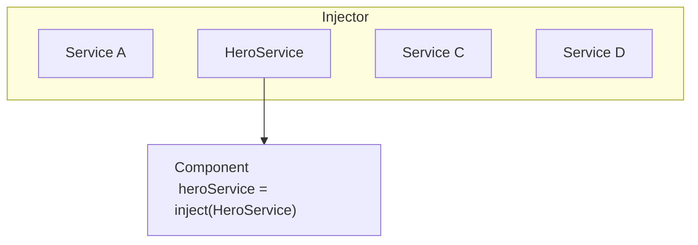

Voici une version traduite, enrichie et structurée de ton README. J'y ai intégré l'ensemble des concepts fondamentaux que nous avons vus (l'intérêt du DI pour le découplage et les tests, l'explication des portées/singletons, et l'ajout indispensable des fournisseurs avancés comme `InjectionToken`, `useValue` et `useFactory` pour les valeurs non-classes).

---

# L'Injection de Dépendances (DI) dans Angular

## Introduction & Concept Fondamental

L'**Injection de Dépendances (Dependency Injection ou DI)** est l'un des piliers fondamentaux d'Angular. C'est un design pattern qui permet à une classe (comme un composant ou un service) de **ne pas créer elle-même** ses dépendances (en évitant les `new MonService()`).

À la place, ces dépendances lui sont **fournies (injectées)** de l'extérieur par le framework.

* **Pourquoi c'est crucial ?** Cela supprime le couplage fort entre les classes, rend le code modulaire, et facilite grandement les tests unitaires (en injectant de faux services ou *mocks*).

Le système repose sur deux acteurs principaux :

1. **Le consommateur de dépendance** (qui a besoin du service).
2. **Le fournisseur de dépendance** (qui déclare comment instancier le service).

Angular fait le lien entre les deux grâce à une abstraction appelée **`Injector`**. Lorsqu'un composant demande un service, l'injecteur vérifie s'il existe déjà une instance disponible dans son registre. Si ce n'est pas le cas, il la crée, la stocke et la transmet.

---

## 1. Fournir une dépendance (Declarer un provider)

La première étape consiste à utiliser le décorateur `@Injectable` pour indiquer qu'une classe peut recevoir des dépendances ou être injectée.

```typescript
@Injectable() // @Service depuis Angular 21/22
class HeroService {}

```

### Option A : Au niveau racine avec `providedIn` (Recommandé)

```typescript
@Injectable({ providedIn: 'root' }) // Dans Angular 22, par defaut c'est providedIn: 'root'
class HeroService {}

```

* **Comportement :** Angular crée une instance unique et partagée (**Singleton**) de `HeroService` pour toute l'application. De plus, cela permet le **Tree-Shaking** (si le service n'est utilisé nulle part, il est automatiquement supprimé du bundle final de production).

### Option B : Au niveau d'un Composant

Tu peux fournir un service directement dans le tableau `providers` d'un composant :

```typescript
@Component({
  selector: 'hero-list',
  template: '...',
  providers: [HeroService]
})
class HeroListComponent {}

```

* **Comportement :** Chaque nouvelle instance de ce composant créera **une nouvelle instance indépendante** du service (ce n'est donc plus un singleton). C'est utile pour isoler l'état d'un composant, mais attention aux effets de bord sur le state partagé !

### Option C : Au niveau global avec `ApplicationConfig`

Tu peux déclarer des providers dans l'objet `ApplicationConfig` passé à la fonction de bootstrap :

```typescript
export const appConfig: ApplicationConfig = {
    providers: [
      HeroService,
    ]
};

```

Puis dans `main.ts` :

```typescript
bootstrapApplication(AppComponent, appConfig)

```

---

## 2. Aller plus loin : Les fournisseurs avancés (`InjectionToken`, `useValue`, `useFactory`)

Par défaut, Angular utilise des classes. Mais comment injecter des valeurs brutes (une URL d'API, un objet de configuration, un booléen) ou instancier des services dynamiquement ? On utilise pour cela un **`InjectionToken`** associé à `useValue` ou `useFactory`.

### `InjectionToken` et `useValue` (Pour les valeurs statiques / configurations)

```typescript
// 1. On crée un token typé
export const API_CONFIG = new InjectionToken<string>('api.config');

// 2. On le fournit avec useValue
export const appConfig: ApplicationConfig = {
    providers: [
      { provide: API_CONFIG, useValue: 'https://api.monsite.com' }
    ]
};

// 3. On l'injecte dans un composant/service
const apiUrl = inject(API_CONFIG);

```

### `useFactory` (Pour l'instanciation dynamique)

Utile lorsque la création du service dépend d'une logique conditionnelle (par exemple, selon l'environnement de production ou le localStorage) :

```typescript
const loggerFactory = () => {
  const isProd = environment.production;
  return isProd ? new RemoteLogger() : new ConsoleLogger();
};

export const appConfig: ApplicationConfig = {
    providers: [
      { provide: Logger, useFactory: loggerFactory }
    ]
};

```

---

## 3. Consommer / Injecter une dépendance

Utilise la fonction moderne `inject()` d'Angular pour récupérer tes dépendances :

```typescript
import { inject, Component } from '@angular/core';

@Component({/* ... */})
export class UserProfile {
  // Utilisation dans l'initialiseur de propriété
  private userClient = inject(UserClient);

  constructor() {
    // Ou utilisation dans le constructeur
    const logger = inject(Logger);
  }
}

```

> **Règle d'or du contexte d'injection :** La fonction `inject()` doit **toujours** être appelée dans un **contexte d'injection synchrone** (propriété de classe ou constructeur). Il est strictement interdit de l'appeler après un `await` ou à l'intérieur d'un `setTimeout`, car Angular perdrait la trace du contexte d'exécution.

---

## Résumé du fonctionnement de l'Injecteur

